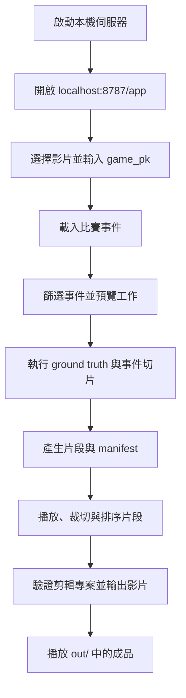

# MLB 精華影片剪輯與旗幟遮罩

這個 repository 維護兩個影片處理領域：MLB 精華影片剪輯，以及旗幟遮罩。另有本機網頁介面串接精華剪輯流程，並可呼叫遮罩工具。

MLB 資料工具整合 `/feed/live` 與 `/content` API，將逐球事件換算成影片時間並標記官方精華，產生 CSV ground truth。事件切片與 `highlight_editor` 負責從片段裁切、合併輸出；`highlight_builder` 提供本機網頁與流程編排。旗幟遮罩工具使用 Grounding DINO 偵測中國國旗、SAM 2 產生遮罩，再將目標模糊或像素化。

`/feed/live` 提供逐球時間；`/content` 提供官方精華標題、長度與播放 URL。ground truth 程式預設輸出所有事件，官方精華只作為標籤，不會過濾掉普通事件；它不是影片分類模型。

## 專案結構
```text
.
├── docs/
│   ├── api/                          # 網頁 API 與剪輯資料格式
│   ├── highlight-editor-integration.md
│   └── superpowers/                  # 設計規格與實作計畫
├── highlight_builder/                # 本機伺服器、CLI 與流程編排
├── highlight_editor/                 # 影格精準裁切、驗證與影片合併
│   ├── tests/
│   ├── README.md
│   └── openapi.yaml
├── sport_hightlight/                 # MLB ground truth 與事件短片產生
│   ├── csv_data/                     # ground truth CSV
│   ├── dataset/                      # 事件短片與 manifest
│   ├── make_clip.py
│   └── mlb_highlight_groundtruth.py
├── target_mask/                      # 國旗偵測與遮罩
│   └── mask_flags.py
├── tests/                            # 網頁後端與工作流程測試
├── web/                              # 首頁與工具頁
└── video/                            # 輸入影片（Git LFS）
```

網頁操作路徑為 `web/` → `highlight_builder/` → MLB 工具、`highlight_editor/` 或 `target_mask/`。`highlight_editor` 也可透過 CLI 或 Python API 獨立使用。

影片使用 Git LFS 管理。實際下載影片前，請先安裝並執行：

```bash
git lfs install
git lfs pull
```

## 安裝依賴

建議使用虛擬環境：

```bash
python3 -m venv .venv
source .venv/bin/activate
python -m pip install requests opencv-python numpy
```

音訊校準另外需要系統已安裝 `ffmpeg`：

```bash
ffmpeg -version
```

影片遮罩另外需要 PyTorch、Transformers、Pillow、SAM 2，以及系統 `ffmpeg`。請先依照 [PyTorch 官方安裝指引](https://pytorch.org/get-started/locally/)安裝適用於目前平台的 `torch` 和 `torchvision`，再安裝其餘套件：

```bash
python -m pip install transformers pillow
python -m pip install git+https://github.com/facebookresearch/sam2.git
```

程式會透過 Hugging Face 載入 Grounding DINO 與 SAM 2 預訓練模型，第一次執行時需要網路連線並下載模型權重。`--device auto` 依序使用 NVIDIA 顯卡（CUDA）、Apple Silicon 的 MPS，都沒有時使用 CPU；也可用 `--device cuda`、`--device mps` 或 `--device cpu` 指定裝置。使用 CUDA 時，請安裝支援 CUDA 的 PyTorch 版本。

## 產生單一半局 ground truth

### bottom2

`--auto-anchor` 會自動尋找影片中首次出現的球場畫面與 live scorebug，避免手動輸入影片起始秒數。

```bash
python sport_hightlight/mlb_highlight_groundtruth.py \
  --game-pk 823734 \
  --video video/eltaMax10_Reds_Brewers_0913_bottom2nd.mp4 \
  --clip-inning 2 \
  --clip-half bottom \
  --auto-anchor \
  --audio-calibrate \
  --out sport_hightlight/csv_data/bottom2_ground_truth.csv
```

目前已驗證的結果：

```text
自動 anchor：約 60.0 秒
全壘打：約 374.9 秒（約 6:15）
音訊校準：約 374.3 秒
```

### top6

```bash
python sport_hightlight/mlb_highlight_groundtruth.py \
  --game-pk 823734 \
  --video video/eltaMax10_Reds_Brewers_0913_top6th.mp4 \
  --clip-inning 6 \
  --clip-half top \
  --auto-anchor \
  --audio-calibrate \
  --out sport_hightlight/csv_data/top6_ground_truth.csv
```

目前已驗證的結果：

```text
自動 anchor：約 34.5 秒
top6 全壘打：約 369.5 秒
```

`--audio-calibrate` 會在事件附近找音訊能量上升沿，並新增：

- `audio_calibrated_video_seconds`：音訊校準後的影片秒數
- `audio_offset_seconds`：相對於 `predicted_video_seconds` 的校正量

原始 API 預測值會保留，方便比較音訊校準前後的差異。搜尋範圍可用
`--audio-search-before` 和 `--audio-search-after` 調整。

## 事件模式

預設輸出指定半局的所有事件。若只需要得分或關鍵字事件，可加入 `--key-events-only`：

```bash
python sport_hightlight/mlb_highlight_groundtruth.py \
  --game-pk 823734 \
  --video video/eltaMax10_Reds_Brewers_0913_bottom2nd.mp4 \
  --clip-inning 2 \
  --clip-half bottom \
  --auto-anchor \
  --key-events-only \
  --out sport_hightlight/csv_data/bottom2_key_events.csv
```

事件配對主要依官方精華的 `id`（多半是 play 描述，或「投手-in-play-打者」）、打者與投手姓名、關鍵字中的球員，以及標題內有出現時的局數/半局；同分無法判定時不標記，同一個 play 有多支精華（如 ABS 挑戰）只保留一支。官方精華 URL 是 MLB 提供的剪輯影片，不是本地完整轉播影片中的時間位置。

## CSV 欄位

- `game_pk`、`video`：比賽與來源影片
- `inning`：局數
- `half`：`top` 或 `bottom`
- `event_type`：事件類型，例如 `Home Run`
- `description`：MLB API 的事件描述
- `is_scoring_play`：是否為得分事件
- `predicted_video_seconds`：事件在影片中的預測秒數
- `audio_calibrated_video_seconds`：音訊校準後的時間
- `is_official_highlight`：是否配對到 MLB 官方精華
- `official_highlight_title`、`official_highlight_duration`、`official_highlight_url`：官方精華資訊
- `batter`、`pitcher`：打者與投手（新版才有；舊 CSV 沒有這兩欄）

## 產生短片資料集

使用 [make_clip.py](sport_hightlight/make_clip.py) 讀取 ground truth，預設擷取事件前 8 秒、後 12 秒，並建立 `positive`、`hard_negative` 與 `manifest.csv`：

```bash
python sport_hightlight/make_clip.py \
  --ground-truth sport_hightlight/csv_data/bottom2_ground_truth.csv \
  --video video/eltaMax10_Reds_Brewers_0913_bottom2nd.mp4 \
  --out-dir sport_hightlight/dataset/bottom2
```

需要系統安裝 `ffmpeg` 與 `ffprobe`。`positive` 是 MLB 官方精華事件，其餘事件放在 `hard_negative`；兩者與 `manifest.csv` 都位於輸出目錄。短片不進版控（見 `.gitignore`），只保留 `manifest.csv`。

每個事件短片是獨立的 ffmpeg 工作，會平行擷取：`--jobs` 控制同時執行的數量（預設為邏輯核心數 / 4，介於 1 到 8），`--preset` 是 libx264 編碼速度（預設 `veryfast`）。libx264 本身已用多執行緒，所以 `--jobs` 開太大不會再變快；`--preset` 越快、檔案越大。在 32 執行緒 CPU（i9-13980HX）上從 1080p 整場影片切 72 段，預設值（`--jobs 8 --preset veryfast`）約 4~5 分鐘，舊設定（`--jobs 1 --preset fast`）約 8~9 分鐘；兩次冷啟動測試分別快 1.98 倍與 1.77 倍（筆電 CPU 滿載會降頻，數字會浮動）；manifest 相同、每段 frame 數相同，總大小從 1.38 GB 降到 1.18 GB。解析度越低，平行的效果越明顯（540p 片段約快 2.8 倍）。短片先寫成 `*.part.mp4`，完成才改名，中斷時不會留下會被略過的殘缺檔。

有 NVIDIA 顯卡或 Intel 內顯時，可用 `--encoder` 改用硬體編碼；品質設定已調到檔案大小、畫質與 libx264 `veryfast` 相近。以下為 i9-13980HX + RTX 4070 Laptop 的實測，SSIM 為抽 4 段與原始影片比較：

| `--encoder` | 需要的硬體 | 速度（相對 libx264 `veryfast`） | SSIM | 說明 |
| --- | --- | --- | --- | --- |
| `libx264`（預設） | 任何 CPU | 1× | 0.9791 | 不同電腦輸出一致，最容易重現 |
| `nvenc` | NVIDIA 顯卡 | 約 2.5×（整場冷啟動 294 → 117 秒） | 0.9773 | `-cq 26`，整場總大小 1.17 GB |
| `qsv` | Intel 內顯 | 約 1.5×（24 段）；整場約 122 秒 | 0.9771 | `-global_quality 22`，整場總大小 1.24 GB，CPU 使用率約 40% |

解碼一律使用 CPU：Intel 硬體解碼（`-hwaccel qsv`）會讓片段固定提早 4 格，NVIDIA／Intel 硬體解碼搭配 libx264 也沒有比較快。`--preset` 只對 libx264 有效。指定的硬體編碼器無法使用時，程式會先試編 1 格並直接報錯。硬體編碼的輸出可能因顯卡或驅動版本略有差異。Apple M 系列的 VideoToolbox 尚未支援，需要先在 Mac 上校正品質設定。

整場資料集（指令見「完整轉播模式」）：72 個 20 秒短片，約 1.2 GB（`--preset fast` 時約 1.4 GB），片段之間沒有重疊；依目前配對規則，`positive` 為 16 個、`hard_negative` 為 56 個。`manifest.csv` 除了標籤與時間，還記錄 `game_pk` 與 `source_video`，合併多場比賽時可追溯來源。已存在的短片預設不重新編碼，需要重切請加 `--overwrite`。

### 篩選事件

`make_clip.py` 可以只剪符合條件的事件；不同條件需同時符合，同一條件內的多個值是「任一符合」。片段檔名中的編號仍是 CSV 原本的列號，改變篩選不會讓檔名變動。

| 參數 | 說明 |
|---|---|
| `--event-types Strikeout "Home Run"` | 只保留這些 `event_type` |
| `--batting-team away` / `--pitching-team home` | 依打擊方或投球方篩選；客隊（away）在上半局打擊 |
| `--batters NAME ...` / `--pitchers NAME ...` | 依打者或投手篩選，需要 CSV 有 `batter`、`pitcher` 欄位 |
| `--innings 7 9` | 局數範圍 |
| `--scoring-only`、`--official-only` | 只保留得分事件、只保留 MLB 官方精華 |
| `--progress-json` | 每處理一個事件就在 stderr 輸出一行 JSON 進度，供後端讀取 |

```bash
python sport_hightlight/make_clip.py \
  --ground-truth sport_hightlight/csv_data/full_game_ground_truth.csv \
  --video video/eltaMax10_Reds_Brewers_0913.mp4 \
  --out-dir sport_hightlight/dataset/823734_reds_strikeout_homerun \
  --event-types Strikeout "Home Run" --batting-team away
```

## 網頁介面（Highlight Builder）

`web/` 是挑選事件並產生片段的網頁，`highlight_builder/` 是它的本機後端。瀏覽器本身不能啟動 Python，因此由本機 HTTP 伺服器提供網頁，並把 API 呼叫轉成 `python -m highlight_builder <指令>` 子程序：結果以一個 JSON 物件輸出到 stdout，進度以 JSON Lines 輸出到 stderr，exit code `0` 成功、`1` 輸入錯誤、`2` 工具錯誤。剪輯輸出由 `highlight_builder` 呼叫 `highlight_editor` 完成。

```bash
python3 -m highlight_builder.server          # http://localhost:8787，工具頁在 /app
python3 -m highlight_builder.server --demo   # 強制示範模式
python3 -m highlight_builder.server --real   # 強制實際執行
```

### 網頁剪輯流程



目前頁面不會自動列出所有可用比賽；載入比賽時需手動輸入 `game_pk`。片段清單會在事件切片工作完成後載入。示範模式只模擬流程，不會建立可播放的片段或成品。

- **示範模式**：沒有安裝 ffmpeg、或 `video/` 裡只有 Git LFS 佔位檔時會自動啟用。執行時走過相同步驟、回報進度，但不呼叫工具、不寫任何檔案，頁面上會標示「示範」。
- **實際執行**：需要 `git lfs pull` 取得影片、安裝 ffmpeg，以及工具用的 Python 套件（`requests`、`opencv-python`、`numpy`）。後端會自動用專案的 `.venv` 執行工具；要用別的 Python 可設定 `HIGHLIGHT_BUILDER_PYTHON=/path/to/python`。
- **API 規格**：`docs/api/highlight-builder.openapi.yaml`（OpenAPI 3.1）。後端拒絕未知的工具、未知的參數，以及超出專案資料夾的路徑，而且不透過 shell 執行。
- **剪輯輸出**：頁面可裁切、排序片段並輸出最終影片；`highlight_editor` 負責影格精準剪輯與合併，整合方式見 [docs/highlight-editor-integration.md](docs/highlight-editor-integration.md)。

CLI 也可以直接使用：

```bash
python3 -m highlight_builder game 823734            # 隊伍、球員、每個打席
python3 -m highlight_builder commands job.json      # 列出會執行的指令
python3 -m highlight_builder run job.json --demo    # 執行（示範模式）
python3 -m unittest discover -s tests -t .           # 測試
```

## 手動指定 anchor

如果影片的轉播版型不同，或自動偵測找不到正確畫面，可以改用手動 anchor：

```bash
python sport_hightlight/mlb_highlight_groundtruth.py \
  --game-pk 823734 \
  --video video/example.mp4 \
  --clip-inning 2 \
  --clip-half bottom \
  --anchor-video-seconds 60.1 \
  --out ground_truth.csv
```

`--anchor-video-seconds` 是指定半局第一個打席開始在影片中的秒數，不一定是影片的第 0 秒。

## 完整轉播模式

整場錄影是連續錄影時，影片時間與 API 時間的偏移量在全場近乎固定，所以用一個 `--game-offset-seconds`（第一個打席在影片中的秒數）換算全部事件。完整流程（在專案根目錄執行）：

```bash
cd /Users/chyan/Projects/eltaProjects
conda activate base

# 1. 產生整場 ground truth
python sport_hightlight/mlb_highlight_groundtruth.py \
  --game-pk 823734 \
  --video video/eltaMax10_Reds_Brewers_0913.mp4 \
  --game-offset-seconds 150.5 \
  --out sport_hightlight/csv_data/full_game_ground_truth.csv

# 2. 刪除舊的短片資料集（避免舊分類殘留）
rm -rf sport_hightlight/dataset/full_game

# 3. 依 ground truth 從整場影片平行切出短片（i9-13980HX 約 4~5 分鐘）
python sport_hightlight/make_clip.py \
  --ground-truth sport_hightlight/csv_data/full_game_ground_truth.csv \
  --video video/eltaMax10_Reds_Brewers_0913.mp4 \
  --out-dir sport_hightlight/dataset/full_game

# 4. 檢查結果（預期 72 筆、16 個 positive、56 個 hard_negative）
python - <<'EOF'
import csv
rows = list(csv.DictReader(open("sport_hightlight/csv_data/full_game_ground_truth.csv")))
print(len(rows), sum(r["is_official_highlight"] == "True" for r in rows))
EOF
ls sport_hightlight/dataset/full_game/positive | wc -l
ls sport_hightlight/dataset/full_game/hard_negative | wc -l
```

第 2 步的 `rm -rf` 會永久刪除 `dataset/full_game/`，執行前請確認路徑。官方精華標記改變時，`positive` 與 `hard_negative` 的分類會跟著改變，所以重跑前需要先刪除舊資料夾；只加 `--overwrite` 的話，舊分類資料夾中的短片不會被移動。

這支影片的值是用已知片段的音訊互相關求得：bottom2 為 151.0 秒、top6 為 150.5 秒，相隔約 3,350 秒仍只差 0.5 秒。輸出的全壘打時間（bottom2：2029.4、top6：5401.5）與獨立量測一致。

求得偏移量的方式：有已知片段時，將片段音訊與整場音訊互相關，得到片段在整場的起點，再加上片段的 anchor 減去該半局的 API 相對時間。

> 測試過「逐半局用 scorebug 邊緣搜尋 anchor」，在這支影片上偏差約 ±15 秒且假邊緣多（轉場、重播），不夠精確，因此沒有採用。直接用整場音訊與事件時間求偏移也不可靠（事件附近的起音離散度太大）。若你的錄影有剪接或廣告，偏移量會隨半局變化，這個模式就不適用。

## 目前限制

- `--auto-anchor` 的視覺啟發式是依目前轉播畫面的球場與右下角 live scorebug 設計；不同電視台或畫面配置可能需要調整。
- 程式使用 API 產生標籤，不會直接從影片畫面辨識事件。
- `--auto-anchor` 找不到可靠訊號時會停止，請改用手動 anchor。
- 音訊校準找的是音量上升沿，可能對應播報、觀眾聲或撞擊聲，不保證就是球棒擊球瞬間；應搭配人工抽查與驗證集評估。
- `game-pk` 必須對應到影片中的同一場比賽。

## 影片國旗遮罩

`target_mask/mask_flags.py` 是獨立於 ground truth 流程的影片處理工具。它預設以 Grounding DINO 搜尋國旗，並用紅色比例、黃色比例、框的長寬比與面積篩選候選框；SAM 2 再依候選框產生像素級遮罩。遮罩會短暫沿用前幾幀以減少閃爍，放大至原影片尺寸並膨脹後，套用模糊或像素化效果。預設 prompt 針對「旗桿上的中國國旗」及「衣物上的中國國旗徽章」。

一般像素化輸出：

```bash
python target_mask/mask_flags.py \
  video/input.mp4 \
  video/masked.mp4 \
  --mode pixelate
```

預設 `--mode blur` 會模糊遮罩區域。可先輸出短片並檢查偵測框：

```bash
python target_mask/mask_flags.py \
  video/input.mp4 \
  video/mask_debug.mp4 \
  --mode debug \
  --max-frames 300
```

`debug` 模式會在遮罩區域加上綠色效果，並以黃色框和分數標示偵測結果；`--max-frames 300` 限制處理前 300 幀，0（預設值）則處理整部影片。輸出影片使用 H.264 編碼，並在來源有音訊時複製音訊串流。請確認系統已安裝 `ffmpeg`。

常用參數如下：

| 參數 | 預設值 | 用途 |
| --- | --- | --- |
| `--mode` | `blur` | 遮罩效果：`blur`、`pixelate` 或 `debug` |
| `--prompt` | 中國國旗旗幟與衣物徽章 | Grounding DINO 文字提示；依其慣例使用小寫句子並以句點結尾 |
| `--device` | `auto` | 運算裝置：`auto`、`cuda`、`mps` 或 `cpu` |
| `--box-thr`、`--text-thr` | `0.10`、`0.10` | 偵測框與文字分數門檻 |
| `--det-width` | `960` | 偵測與分割使用的縮圖寬度 |
| `--hold` | `3` | 在當前遮罩之外，合併最多 3 個先前影格的遮罩以減少閃爍 |
| `--dilate` | `15` | 全尺寸遮罩膨脹像素數；設為 0 可停用 |
| `--max-boxes` | `5` | 每幀最多處理的偵測框數 |

偵測門檻也可用 `--min-aspect`、`--min-red-ratio`、`--min-yellow-ratio` 與 `--min-area-ratio` 調整。程式只會處理符合目前 prompt 與顏色/形狀條件的目標；不同旗幟、徽章、畫面色彩或轉播版型可能需要調整 prompt 和門檻，請先用 `debug` 模式抽查結果。這是逐幀偵測與分割，不保證每一幀都能正確追蹤目標。

## 下一步

可以使用 `sport_hightlight/csv_data/bottom2_ground_truth.csv` 作為開發樣本，調整影片特徵與偵測規則，再用 `sport_hightlight/csv_data/top6_ground_truth.csv` 作為未參與調參的驗證樣本，計算精華事件偵測的 precision、recall 與時間誤差。
